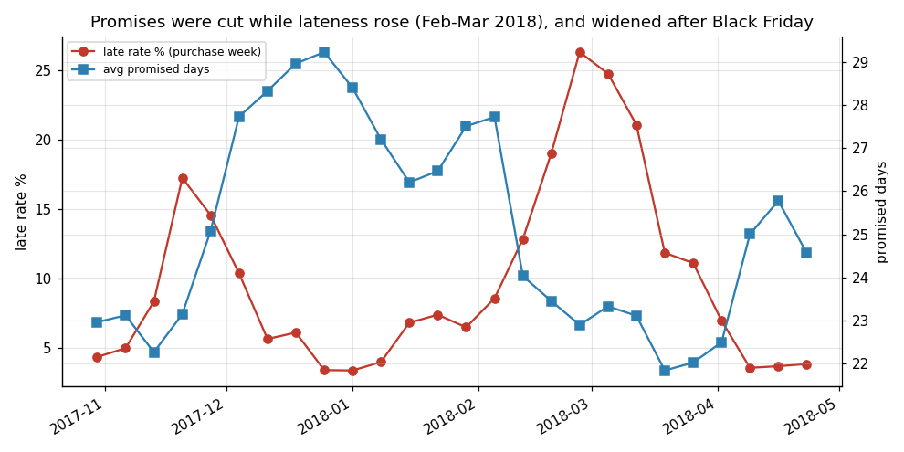
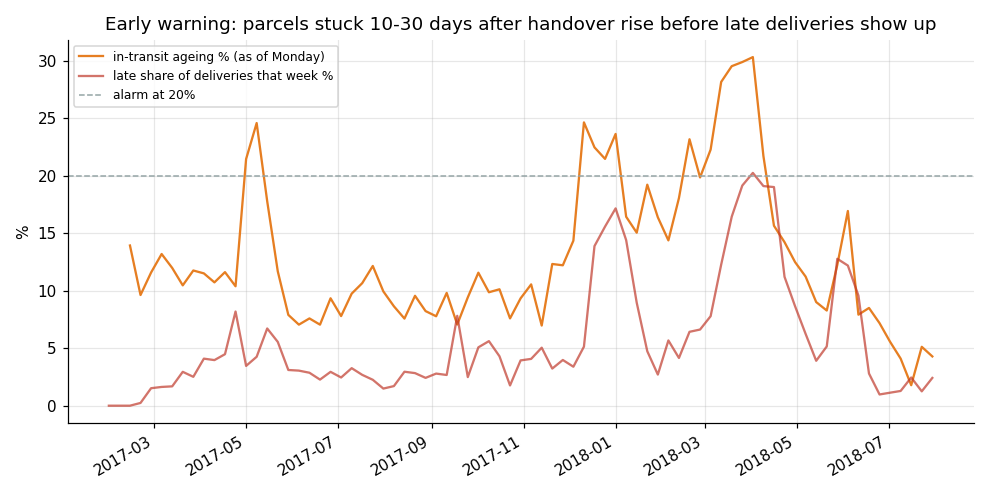
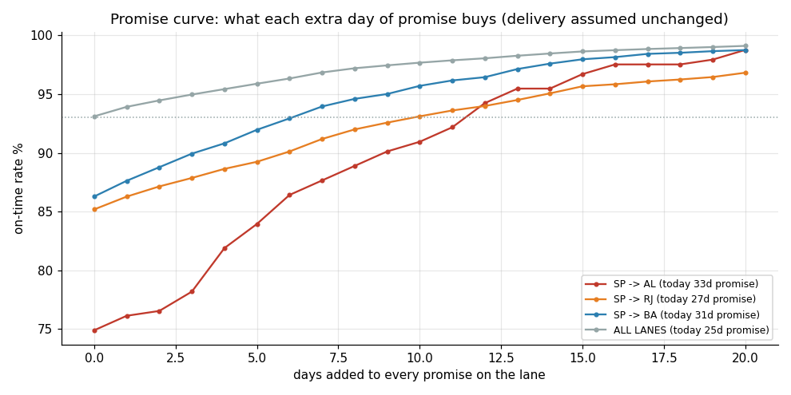

# Olist supplier & delivery control tower

Where do late deliveries come from, what do they cost, and what would catch
the problem early? A portfolio case study on
[Olist's public Brazilian marketplace dataset](https://www.kaggle.com/datasets/olistbr/brazilian-ecommerce)
(about 100k real orders, 2016-2018).

**Dashboards (live):** [Findings](https://chinmaykadli.github.io/olist-delivery-control-tower/) ·
[Operations: peaks, lanes, seller queue](https://chinmaykadli.github.io/olist-delivery-control-tower/ops.html)





## Hiring for...

- **Project manager** -> [`pm/`](pm/): charter, requirements with acceptance
  criteria, RAID log of real data defects, UAT trace log, and the rollout
  plan (Gantt, RACI, power calculation) for what the memo recommends.
- **Supply chain / operations** -> [Operations dashboard](https://chinmaykadli.github.io/olist-delivery-control-tower/ops.html)
  and [`sql/04_lane_views.sql`](sql/04_lane_views.sql): peak analysis, a
  carrier early-warning signal with a backtested promise guardrail, lane
  Pareto, lead-time variability, promise curves and the seller exception queue.
- **Analyst** -> [`sql/`](sql/) + [`analysis/`](analysis/): DuckDB schema
  with 14 quality checks, metric views, window-function features, an
  out-of-time backtest with confidence intervals, and a repeat-purchase
  logistic regression.
- **Founder's associate / commercial** -> [`memo/decision-memo.md`](memo/decision-memo.md):
  a 2-page memo with the options table, the cost of lateness and a pilot design.

## Headline findings

Analysis window: 90,119 delivered orders, Sep 2016 - Jul 2018; 6.8% late.

1. **Lateness is a peak problem first.** Three months (Nov 2017, Feb 2018,
   Mar 2018; rule: marketplace late rate of 10% or more) hold 23% of orders
   but 51% of late orders. In peak months the average promise was 23.6 days
   against 25.3 normally, while transit took 12.5 days against 8.7. In
   Feb-Mar 2018 weekly promises fell from 27.7 to 22.9 days as the weekly
   late rate climbed to 26%.
2. **Most delay sits with the carrier.** Late orders wait 3 extra days for
   seller handover (6.0 vs 3.1) but spend 21 extra days in transit (29.2 vs
   8.1).
3. **A carrier slowdown is visible early.** The share of parcels handed over
   10-30 days ago and still undelivered crossed 20% on 2018-02-19, 3 weeks
   before the late share of deliveries passed 10%. Backtest: adding 5 days to
   promises in the 13 alarm weeks would have turned 727 late orders on time
   (12% of all late orders). Threshold set in-sample; see Limits.
4. **Promises are mis-calibrated, not just short.** The median order arrives
   13 days early, yet SP -> AL is only 75% on time and needs +12 days to
   reach 93%. Two lanes (SP -> SP and SP -> RJ) carry 38% of late orders;
   SP -> RJ is 7.5% late in normal months and 37.7% in peaks.
5. **Reviews punish lateness, but the survey fires early.** 72% of late-order
   reviews were answered before the parcel arrived (the survey is sent when
   the estimate passes). Late orders reviewed after arrival average 3.69
   stars against 4.28 on time.
6. **The repeat-purchase cost is small and measurable.** Customers whose first
   order was late repeat at 2.92% vs 4.05%; adjusted odds ratio 0.80
   (95% CI 0.65 to 0.97). That is roughly 29 lost repeat orders (95% CI 6 to
   52) across 3,670 late first orders: lateness costs reviews far more than
   measurable repeat revenue.
7. **Simple beats clever for the seller call list.** 20 sellers a month ranked
   by trailing 90-day late rate turn bad 34% of the time (95% CI 26% to 42%)
   against a 21% base rate on Jan-Jul 2018, 1.59x random. A 5-feature
   logistic model does no better (33%). The rule was chosen on 2017 only.

**Recommendation:** peak-aware promises with an in-transit ageing guardrail;
a 20-seller monthly call list on the one-line rule; survey on delivery
confirmation. No throttling. See the [memo](memo/decision-memo.md).

## Metric definitions

- **late** = delivered to the customer on a later *calendar date* than the
  estimated delivery date (the estimate has no time component). Delivered
  orders only.
- **on-time rate** = 1 - late rate. (Not "OTIF": item-level fulfilment is
  not in the data, so "in full" cannot be measured.)
- **dispatch days** = purchase -> carrier handover (seller side; includes
  about half a day of payment approval).
- **transit days** = carrier handover -> customer delivery (carrier).
- **shipping-limit breach** = handover after the item's own
  `shipping_limit_date`.
- **review answered before delivery** = `review_answer_timestamp` earlier than
  the delivery timestamp (`review_creation_date` is when the survey was sent).
- **in-transit ageing** = as of a Monday, share of orders handed to the
  carrier 10-30 days earlier that are still undelivered. Uses no future data.
- **peak month** = marketplace late rate of 10% or more.

## Rebuild

```bash
pip install -r requirements.txt
make all        # download data, build DB, run analyses, build dashboards, check numbers
```

`make all` runs `scripts/download_data.sh`, `analysis/build_db.py`,
`analysis/run_analysis.py`, `analysis/scorecard_backtest.py`,
`analysis/lanes_analysis.py`, `dashboard/build_dashboard.py`,
`dashboard/build_ops.py` and `scripts/check_numbers.py`, which fails if any
number quoted in this README or the memo no longer matches `outputs/`.

## Limits (read before quoting numbers)

- **Window:** purchases Sep 2016 - Jul 2018, set once in `v_params`. Aug 2018
  onwards is excluded (too close to the data cut-off). Worst case for Jun-Jul
  2018, counting every still-open order as late: June 1.2% -> 1.9%, July
  3.4% -> 4.5% (`outputs/censoring_bound.csv`).
- **Delivered orders only** for lateness. Cancelled and unavailable orders are
  not attributed to sellers: 603 of 609 unavailable orders have no items.
- **Multi-seller orders (1.3%)** excluded from seller metrics: carrier
  handover is order-level and cannot be attributed.
- **Promise backtests** (guardrail, promise curve) assume delivery times do
  not change when the promise changes, and the data has no conversion
  figures, so the commercial cost of longer promises is not measured.
- **The ageing threshold (20%)** was set in-sample on two episodes; the May
  2017 alarms preceded only a mild rise. Treat it as a hypothesis to monitor.
- **No take rate or margin** in the data: GMV is reported, never revenue saved.
- **Associations, not causes.** One country, 2016-2018. Carrier identity is
  not in the data.

## Notes

- Code: MIT licence. Data: Olist, CC BY-NC-SA 4.0 (no data files in repo).
- Built with AI assistance; every query is explained in `sql/` and
  `analysis/` and can be defended line by line.
- Case study: not work performed for Olist or any employer.
