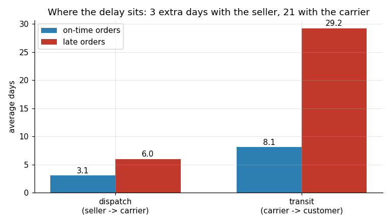
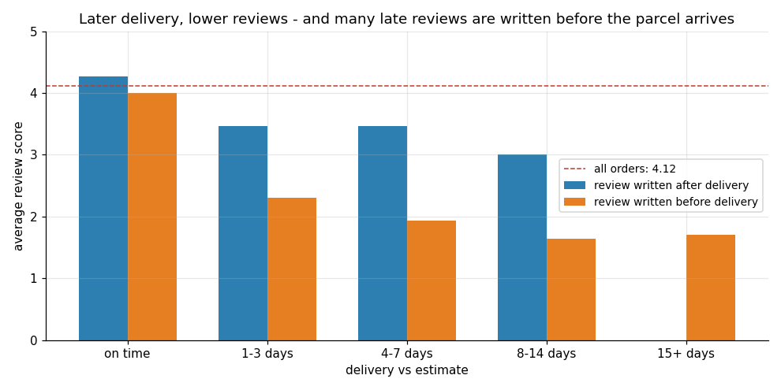
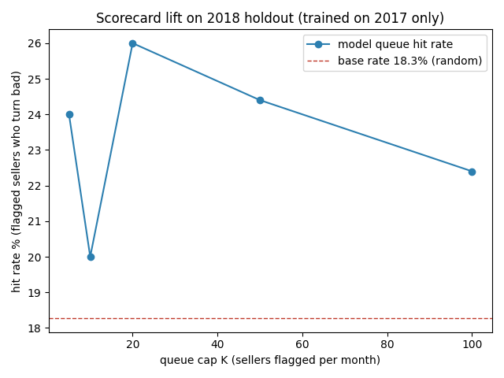

# Olist supplier & delivery control tower

Where do late deliveries come from, what do they cost, and what rule would
catch a problem seller early? A portfolio case study on
[Olist's public Brazilian marketplace dataset](https://www.kaggle.com/datasets/olistbr/brazilian-ecommerce)
(~100k real orders, 2016-2018).

**Dashboard (live):** see the link under About / in `docs/index.html`.





## Hiring for...

- **Project manager** -> [`pm/`](pm/): charter, requirements with acceptance
  criteria, RAID log of real data defects, UAT trace log, and the pilot
  rollout plan (Gantt + RACI) this analysis recommends.
- **Analyst** -> [`analysis/`](analysis/) + [`sql/`](sql/): DuckDB schema with
  11 quality checks, metric views, and a logistic early-warning score
  backtested out-of-time with a lift curve.
- **Founder's associate** -> [`memo/decision-memo.md`](memo/decision-memo.md):
  a 2-page memo with the options table, pilot design and KPI tree.

## Headline findings

1. **Most delay is the carrier, not the seller.** Late orders spend 3 extra
   days waiting for seller handover but 21 extra days in transit
   (6.0 vs 3.1 dispatch days; 29.5 vs 8.5 transit days).
2. **Lateness still costs about a star.** 1-2 star share: 9% on time ->
   81% at 8-14 days late. But 76% of late-order reviews were written
   *before the parcel arrived* (the survey fires when the estimate passes) -
   written after delivery, late orders average ~3.4 stars, not 2.2.
3. **The worst sellers are real but few.** Worst decile of 511 sellers (30+
   orders): 19.2% late vs 6.8% for the rest - yet only 13% of all late
   orders. Persistence is tail-only: the worst 2017 decile stayed the worst
   group in 2018 (14.1%).
4. **The early-warning score is honest, not magical.** Logistic model on
   trailing-90-day dispatch, shipping-limit breach, late rate, review,
   cancellations and volume. Top-20 monthly queue: 26% hit rate vs 18% base
   (1.4x lift) on Jan-May 2018, a period it was not trained on. Good enough
   for a weekly conversation queue; never for automatic throttling.
5. **Recommendation:** capped review queue + route-level promise
   recalibration (SP-AL to a 36-day 80th percentile) + survey trigger moved
   to delivery confirmation. No throttling.

## Metric definitions

- **late** = delivered to the customer on a later *calendar date* than the
  estimated delivery date (the estimate has no time component). Delivered
  orders only.
- **on-time rate** = 1 - late rate. (Not "OTIF": item-level fulfilment is
  not in the data, so "in full" cannot be measured.)
- **dispatch days** = purchase -> carrier handover (seller-controllable).
- **transit days** = carrier handover -> customer delivery (carrier).
- **shipping-limit breach** = handover after the item's own
  `shipping_limit_date`.

## Rebuild (four commands)

```bash
pip install -r requirements.txt
./scripts/download_data.sh            # 8 CSVs from Olist's public mirror
python analysis/build_db.py           # schema + 11 quality checks + views
python analysis/run_analysis.py       # metrics, charts, forecast appendix
python analysis/scorecard_backtest.py # early-warning score + lift
python dashboard/build_dashboard.py   # docs/index.html
```

Verified on a clean checkout. The dashboard is static Plotly HTML in `docs/`
(served by GitHub Pages).

## Limits (read before quoting numbers)

- **Window:** purchases Sep 2016 - May 2018. Jun-Aug 2018 excluded:
  right-censoring (late orders still in transit at the data cut-off).
- **Delivered orders only** for lateness; cancelled orders counted separately
  in the scorecard's cancellation feature.
- **Multi-seller orders (1.2%)** excluded from seller metrics: carrier
  handover is order-level and cannot be attributed.
- **No take rate / contract terms** in the data: GMV exposed is reported,
  never "revenue saved".
- **Associations, not causes.** One country, 2016-2018.

## Notes

- Code: MIT licence. Data: Olist, CC BY-NC-SA 4.0 (no data files in repo).
- Built with AI assistance; every query is explained in `analysis/` and can
  be defended line by line.
- Case study: not work performed for Olist or any employer.
