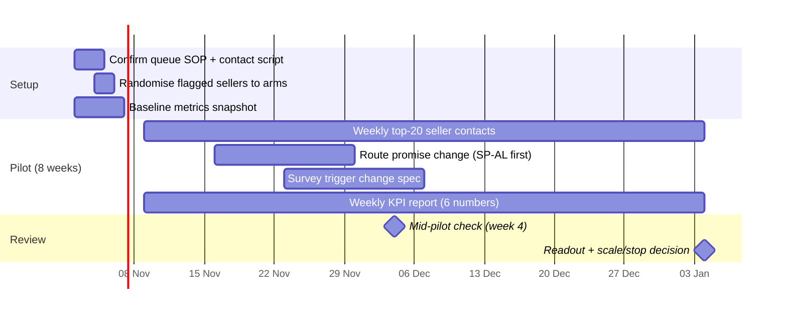

# Pilot plan - seller review queue + route promises

The recommended 8-week pilot from the decision memo. Gantt and RACI describe
the ROLLOUT (the thing a founder would run), not the analysis build.

## RACI

Roles: Seller Ops (contacts sellers), Logistics (carrier + routes), CX
(reviews, survey), Data (score, KPI report), Founder/Head of Marketplace
(decision).

| Activity | Seller Ops | Logistics | CX | Data | Founder |
|---|---|---|---|---|---|
| Weekly queue contacts | R/A | I | I | C | I |
| Route promise recalibration | I | R/A | C | C | A |
| Survey trigger change | I | I | R/A | C | A |
| Score refresh + lift monitoring | I | I | I | R/A | I |
| KPI weekly report | C | C | C | R/A | I |
| Scale/stop decision | C | C | C | C | R/A |

## Sizing note

Detecting a late-rate drop from 16% to 12% needs ~1,200 orders per arm
(two-proportion test, 80% power). Seller clustering raises this; treat as a
floor and report power with the readout.
