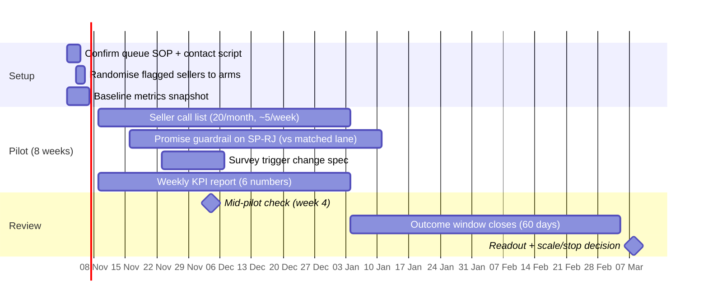

# Pilot plan - promise guardrail, seller call list, survey trigger

The recommended 8-week pilot from the decision memo. Gantt and RACI describe
the ROLLOUT (the thing a founder would run), not the analysis build.

## RACI

Roles: Seller Ops (contacts sellers), Logistics (carrier + routes), CX
(reviews, survey), Data (score, KPI report), Founder/Head of Marketplace
(decision).

| Activity | Seller Ops | Logistics | CX | Data | Founder |
|---|---|---|---|---|---|
| Monthly call list (5/week) | R/A | I | I | C | I |
| Promise guardrail + ageing watch | I | R/A | C | C | A |
| Survey trigger change | I | I | R/A | C | A |
| Score refresh + lift monitoring | I | I | I | R/A | I |
| KPI weekly report | C | C | C | R/A | I |
| Scale/stop decision | C | C | C | C | R/A |

## Sizing note (from `outputs/lanes_summary.json`)

- Unit of randomisation: the **seller**, not the order. Lateness is correlated
  within a seller (ICC 0.024, estimated from 2018 data), and a listed seller
  has about 15 orders in a 60-day outcome window, so the design effect is 1.33.
- Listed sellers run 12.8% late in the listed month. Detecting a quarter fewer
  late orders (12.8% -> 9.6%) at 80% power needs 2,031 orders, about 136
  sellers, per arm: roughly 14 months of intake at 10 sellers per arm per month.
- An 8-week intake (20 sellers per arm) can only detect a drop to 5.3%.
- Decision: run the call list as standard practice with monitoring; use the
  shipping-limit breach rate as the primary pilot metric because it moves
  within days; report the achieved power at readout. The scale or stop rule is
  written before the first call.
- Timeline: an 8-week intake plus a 60-day outcome window means the readout is
  in March 2027, not at the end of intake.
